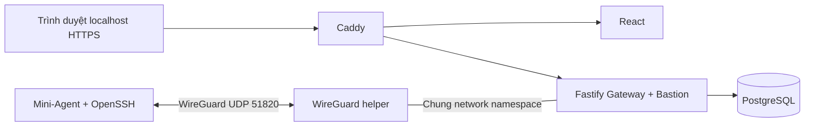

# ZT-ServerOps / trust-me-bro

Đồ án cơ sở ngành Nhóm 9: quản trị máy chủ qua WireGuard, giám sát tài nguyên và
Web SSH có phân quyền ADMIN/VIEWER. Nhánh làm việc: **`minh-thanh`**; không merge
vào `main`. Phạm vi là mô hình môn học chạy được và giải thích được.

## Khởi chạy demo

Cần Linux có kernel WireGuard, Docker Engine + **Docker Compose v2**, Python 3,
OpenSSL và `ssh-keygen`. Tài khoản chạy cần quyền truy cập Docker. Lần build đầu
cần Internet để tải image/phụ thuộc. Không cần cài Node.js hoặc npm lên host.
Gateway chạy với UID1000: owner của khóa bind-mount quyền400 phải khớp UID này.
Máy đã kiểm chứng có `id -u` bằng1000; host dùng UID khác cần cấu hình quyền đọc phù hợp.

Từ thư mục repository:

```sh
python3 deploy/scripts/demo.py up
python3 deploy/scripts/demo.py check
python3 deploy/scripts/demo.py status
```

Mở **https://localhost**. Caddy dùng chứng chỉ CA nội bộ cho demo: trình duyệt cần
chấp nhận chứng chỉ cục bộ hoặc tin cậy CA này. Tài khoản **`demo-admin`** và
**`demo-viewer`**, mật khẩu được sinh ngẫu nhiên trong `keys/demo-login.env`
(quyền 600). Xem tệp này cục bộ; không đưa vào ảnh, slide hoặc Git.

`up` tạo `keys/demo.env`, khóa và cấu hình nếu chưa có, build, migrate DB, cấp
role DB, tạo hai tài khoản/node rồi chạy worker. Lặp lại không đổi mật khẩu,
khóa hoặc UUID. Nếu định danh đã có cấu hình khác, CLI dừng và giữ dữ liệu.

Cụm có tên `zt_demo` và volumes riêng. `.env`, khóa đã có và DB của bản Round 4
được giữ nguyên. Dừng cụm **không xóa volume**:

```sh
python3 deploy/scripts/demo.py down
```

`make up`, `make e2e`, `make status`, `make down` tương ứng các lệnh trên.
`make test` chạy unit test Agent và Gateway trong Docker; DB/fetch của test
Gateway là giả lập. `make e2e` kiểm tra hệ thống thật và cảnh báo bằng payload
kiểm thử trong DB tạm riêng. Không dùng `make clean` để dọn dữ liệu kiểm chứng.

## Mô hình đang chạy



- Gateway chỉ publish **UDP 51820** ra NIC ngoài. HTTP/HTTPS của demo bind
  **127.0.0.1**; PostgreSQL và Fastify không publish port.
- Worker không publish port. SSH chỉ nghe `10.100.0.2:22`; firewall trong
  namespace worker chặn kết nối qua NIC transport. Agent gửi tới
  `http://10.100.0.1:3000` qua WireGuard. Helper chỉ cấu hình mạng của container,
  không sửa firewall host.
- Bastion dùng Ed25519, private key quyền **400**, kiểm tra fingerprint host key.
  Tài khoản SSH demo là `ztuser`; ADMIN là quyền ứng dụng, không có nghĩa shell
  chạy root. Viewer đọc số liệu và bị từ chối cấp vé SSH tại backend.
- Heartbeat mặc định **3 giây**. Nhãn `Online/Stale/Offline` tương ứng giá trị DB
  `HEALTHY/WARNING/OFFLINE`. Stale từ 15s, Offline từ 30s, chu kỳ quét 5s.
  CPU vượt ngưỡng là incident riêng, không làm node thành Stale.
- Telegram mặc định **`TELEGRAM_MODE=dry-run`**: ghi log có nhãn GIẢ LẬP,
  không polling và không gửi ra ngoài, kể cả khi có token. Kết nối Bot thật
  được hoãn theo chủ dự án; chưa được kiểm chứng.

## Cấu hình cần biết

Chỉnh **`keys/demo.env`** cho cụm demo, không chỉnh `.env` cũ theo phỏng đoán.

| Biến | Mặc định demo | Mục đích |
|---|---|---|
| `HTTP_PORT`, `HTTPS_PORT` | 80, 443 | Đổi nếu host đang dùng cổng này |
| `PROXY_BIND_IP` | 127.0.0.1 | Web console cục bộ; không mở Internet |
| `BASTION_DEFAULT_USER` | ztuser | Tài khoản SSH trên máy con |
| `NODE_STALE_THRESHOLD_SECONDS` | 15 | Mất nhịp sang Stale |
| `NODE_OFFLINE_THRESHOLD_SECONDS` | 30 | Mất nhịp sang Offline, giới hạn 15–45s |
| `SWEEPER_INTERVAL_MS` | 5000 | Chu kỳ kiểm tra trạng thái |
| `CPU_ALERT_THRESHOLD_PERCENT` | 85 | Ngưỡng incident CPU |
| `TELEGRAM_MODE` | dry-run | Giả lập; chưa bật live |
| `NODE_TOKEN_01` | Sinh ngẫu nhiên | Khớp hash node đã đăng ký |

Toàn bộ mẫu biến trong [.env.example](.env.example). Khóa và mật khẩu nằm trong
`keys/` được Git/Docker build context loại trừ. Đổi môi trường demo khác bằng
`--env-file PATH --project TEN` ở mọi lệnh `demo.py`; phải chọn cổng host khác
nếu chạy đồng thời. Khi đổi Gateway container, dùng `up` cho cả cụm để helper
WireGuard dùng đúng namespace, không recreate riêng Gateway.

## Đối chiếu và kiểm chứng

| Yêu cầu | Hiện trạng | Bằng chứng | Việc còn thiếu |
|---|---|---|---|
| WireGuard M2M, Zero Inbound worker | Có VPN kernel, SSH chỉ qua VPN, không publish worker | `network-resources.txt`, runtime SSH | Chưa thử từ Internet/VM riêng |
| ADMIN/VIEWER, Web SSH/PTY | Viewer nhận403; Admin chạy lệnh, resize, đóng; logout thu hồi phiên | 16 kiểm tra `runtime.txt`, ảnh terminal | Không |
| CPU/RAM/disk/network/uptime, dashboard | Collector thật, API và biểu đồ cập nhật | Browser desktop/tablet/mobile | RAM Agent chưa đạt mốc khoảng10MB |
| Heartbeat3s, Online/Stale/Offline | Ngưỡng15/30s, quét5s | Stale17,80s, Offline32,82s; tự phục hồi | Không trong cấu hình demo |
| Cảnh báo CPU/offline | Lưu incident/audit, resolve và tránh lặp | Payload/timestamp giả lập + PostgreSQL thật trong DB test riêng | Telegram thật hoãn |
| PostgreSQL, chuẩn hóa dữ liệu | Migration008 bỏ tỷ lệ RAM/disk lưu dư; API tính từ bytes | Test nâng007→008 giữ UUID/FK/lịch sử; fresh DB cũng chạy | Không đổi migration cũ |
| VM và Docker | Cụm Docker đã chạy thật | `VM_SETUP.md` có hướng dẫn | Cần môi trường VMware/VirtualBox để kiểm chứng |

Các bằng chứng trong `docs/verification/`: `build-start.txt`, `unit.txt`
(11 Agent + 11 Gateway; DB/fetch của Gateway được mock), `runtime.txt`
(16 luồng trên cụm thật, cảnh báo với dữ liệu kiểm thử, nâng cấp DB cô lập),
`browser.txt`, `liveness.txt` và `network-resources.txt`.

Các bài Python dò chuỗi source và test nâng cấp Round4 cũ được giữ nguyên;
chúng có kỳ vọng cũ như khóa600, timeout10s, tỷ lệ RAM/disk lưu trong schema007.
Chúng không được dùng để gán PASS cho chức năng hiện tại. Riêng test nâng cấp
008 dùng `tests/runtime-schema.cjs`; không sửa test cũ để che lỗi.

Build còn ghi nhận **4 cảnh báo phụ thuộc** (1 moderate, 2 high, 1 critical).
Chưa thực hiện nâng major framework trong phạm vi phiên này; đây là giới hạn
an toàn cần biết, không coi bản demo là đã vượt audit production.

## Tài liệu và giới hạn

- [Kịch bản demo và xử lý lỗi](docs/DEMO.md).
- [Log và ảnh kiểm chứng](docs/verification/).
- [Mô hình hai VM](docs/VM_SETUP.md): hướng dẫn, **chưa kiểm chứng hypervisor**.
- [API](contracts/openapi.yaml): các endpoint đang hỗ trợ được ghi trong đặc tả.

Các luồng chính đã chạy thật trong cụm Docker; xem log và ảnh trong `docs/verification/`.
Mini-Agent đo khoảng **23 MiB RSS**, chưa đạt mục tiêu khoảng 10 MB trong phiếu.
Cụm đo khoảng **112 MiB** tại tải demo; đây là snapshot, không phải benchmark.
Mô hình VM và thử inbound từ Internet thật còn cần xác nhận. Telegram live
được hoãn theo chủ dự án. Slide và báo cáo môn học nằm ngoài công việc phiên này. Không nhận bản này là hệ thống production.
Các báo cáo Round 1–4 là lịch sử tham khảo, không thay thế bằng chứng hiện tại.
