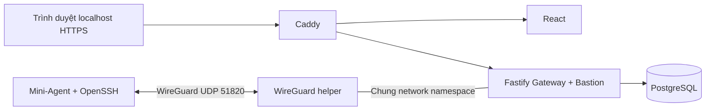

# ZT-ServerOps / trust-me-bro

Đồ án cơ sở ngành Nhóm 9: quản trị máy chủ qua WireGuard, giám sát tài nguyên và
Web SSH có phân quyền ADMIN/VIEWER. Nhánh làm việc: **`minh-thanh`**; không merge
vào `main`. Phạm vi là mô hình môn học chạy được và giải thích được.
Gateway giữ Fastify 5/TypeScript, Dashboard giữ React/TypeScript, DB giữ PostgreSQL.
Mini-Agent dùng Go và thư viện chuẩn; phiếu giao không cố định ngôn ngữ Agent.
Agent Linux đã chạy thật; collector/service Windows đã bổ sung và cross-build,
**chưa kiểm chứng trên Windows VM**. Mô hình chọn là máy Arch Linux hiện tại chạy
Gateway Docker + Windows VM Worker riêng; xem [Windows Worker](docs/WINDOWS_WORKER.md).

## Khởi chạy demo

Cần Linux có kernel WireGuard, Docker Engine + **Docker Compose v2**, Python 3.9+,
OpenSSL và `ssh-keygen`. Tài khoản chạy cần quyền truy cập Docker. Lần build đầu
cần Internet để tải image/phụ thuộc. Không cần cài Node.js hoặc npm lên host.
Gateway chạy với UID1000: owner của khóa bind-mount quyền400 phải khớp UID này.
Máy đã kiểm chứng có `id -u` bằng1000; host dùng UID khác cần cấu hình quyền đọc phù hợp.

Từ thư mục repository:

```sh
python3 deploy/scripts/demo.py up
python3 deploy/scripts/demo.py doctor
python3 deploy/scripts/demo.py check
python3 deploy/scripts/demo.py status
```

Mở **https://localhost**. Caddy dùng chứng chỉ CA nội bộ cho demo: trình duyệt cần
chấp nhận chứng chỉ cục bộ hoặc tin cậy CA này. Tài khoản **`demo-admin`** và
**`demo-viewer`**, mật khẩu được sinh ngẫu nhiên trong `keys/demo-login.env`
(quyền 600). Xem tệp này cục bộ; không đưa vào ảnh, slide hoặc Git.

`up` tạo `keys/demo.env`, khóa và cấu hình nếu chưa có, build, migrate DB, cấp
role DB, tạo hai tài khoản/node rồi chạy worker. Lặp lại không đổi mật khẩu,
khóa hoặc UUID. Nếu định danh đã có cấu hình khác, CLI dừng và giữ dữ liệu.

Cụm có tên `zt_demo` và volumes riêng. `.env`, khóa đã có và DB của bản Round 4
được giữ nguyên. Dừng cụm **không xóa volume**:

```sh
python3 deploy/scripts/demo.py down
```

`make up`, `make doctor`, `make e2e`, `make status`, `make down` tương ứng các lệnh trên.
`make test` chạy Go tests Linux của Agent và Vitest của Gateway trong Docker; DB/fetch của test
Gateway là giả lập. `make e2e` kiểm tra hệ thống thật và cảnh báo bằng payload
kiểm thử trong DB tạm riêng; có login/logout nên thu hồi phiên của tài khoản demo
trên cụm được chọn. `make clean` chỉ xóa bytecode Python và cache rỗng; giữ log,
khóa, tài liệu, symlink và volume DB. `make mock` là dry-run, không gửi HTTP hoặc đo tải Gateway.

Các lệnh Make nhận `PROJECT`, `ENV_FILE` và `PYTHON`. Ví dụ chọn cụm thử đã cấu hình
cổng/subnet riêng:

```sh
make doctor PROJECT=zt_completion_check ENV_FILE=keys/completion-check.env
```

`doctor` chỉ đọc trạng thái container, readiness, DB, tuổi heartbeat, handshake và
banner SSH; không tạo tài khoản, gửi Telegram, đăng nhập/logout hoặc sửa firewall.
Lệnh trả mã khác 0 khi phát hiện vấn đề; banner không thay nghiệm thu SSH/PTY
có xác thực, host-key verification hoặc Zero Inbound từ máy khác. HTTPS probe
dùng CA demo nên không chứng nhận máy đã tin cậy CA. Lệnh kiểm tra không tự sinh
mật khẩu nếu thiếu `keys/demo-login.env`; cần khôi phục đúng tệp của cụm cũ.

## Nhật ký hoạt động

Đăng nhập bằng ADMIN, chọn **Nhật ký hoạt động** trên sidebar. Màn hình đọc
`audit_logs` thật: đăng nhập thành công/thất bại, đăng xuất, cấp vé/mở/đóng phiên SSH,
CPU vượt ngưỡng và máy chủ Offline. Tìm theo tài khoản, tên/IP máy chủ hoặc IP
ghi nhận; lọc loại sự kiện và xem 25 bản ghi mỗi trang. Nhấn **Làm mới** để lấy
sự kiện mới. Có thể mở chi tiết để đối chiếu ID phiên SSH và thông số cảnh báo.

API `GET /api/audit/logs` chỉ cho ADMIN; VIEWER nhận403 kể cả gọi trực tiếp.
Không có API sửa/xóa nhật ký. Chỉ các trường chi tiết được cho phép mới được trả
về; không trả token, mật khẩu, khóa hoặc raw JSON audit. Đăng nhập giới hạn
10 yêu cầu/IP/phút trước DB/ghi log. Log thất bại lưu tài khoản đã thử, IP và lý do;
không lưu mật khẩu. Module ghi vòng đời SSH, không ghi nội dung lệnh.
IP START/END của phiên mới theo request WebSocket. Gateway chỉ tin forwarded headers từ đúng
Caddy được chỉ định; kết nối trực tiếp dùng IP socket. Role DB ứng dụng không có
quyền sửa/xóa/truncate audit; không tuyên bố chống được quản trị viên DB.

## Mô hình đang chạy



- Gateway chỉ publish **UDP 51820** ra NIC ngoài. HTTP/HTTPS của demo bind
  **127.0.0.1**; PostgreSQL và Fastify không publish port.
- Worker không publish port. SSH chỉ nghe `10.100.0.2:22`; firewall trong
  namespace worker chặn kết nối qua NIC transport. Agent gửi tới
  `http://10.100.0.1:3000` qua WireGuard. Helper chỉ cấu hình mạng của container,
  không sửa firewall host.
- Bastion dùng Ed25519, private key quyền **400**, kiểm tra fingerprint host key.
  Tài khoản SSH demo là `ztuser`; ADMIN là quyền ứng dụng, không có nghĩa shell
  chạy root. Viewer đọc số liệu và bị từ chối cấp vé SSH tại backend.
- Heartbeat mặc định **3 giây**. Nhãn `Online/Stale/Offline` tương ứng giá trị DB
  `HEALTHY/WARNING/OFFLINE`. Stale từ 15s, Offline từ 30s, chu kỳ quét 5s.
  CPU vượt ngưỡng là incident riêng, không làm node thành Stale.
- CPU/RAM/uptime là số liệu hệ điều hành chạy Agent; bản Linux Docker dùng kernel host,
  không phải mức sử dụng cgroup riêng của container. Disk là filesystem tại
  `DISK_MOUNT_POINT`. RX/TX là byte tích lũy trên **một** `NETWORK_INTERFACE`
  (demo: `wg0`), không cộng cả WireGuard và NIC transport, không phải byte/s.
  Windows dùng Win32, disk có xét quota của tài khoản Agent, không gửi Linux load_avg.
  Bộ đếm mạng có thể reset khi giao diện được tạo lại. Lỗi collector bỏ beacon
  và ghi nguyên nhân, không gửi số 0 giả; Offline chỉ biểu thị mất heartbeat.
- Dashboard có thời điểm tải thành công và tuổi heartbeat; mất kết nối Gateway
  được phân biệt với nodeOffline. Bấm thẻ Online/Stale/Offline để lọc; chart đặt
  mẫu theo timestamp thật và ngắt đường khi khoảng mẫu hơn15s, không nội suy mất dữ liệu.
- Telegram mặc định **`TELEGRAM_MODE=dry-run`**: ghi log có nhãn GIẢ LẬP,
  không polling và không gửi ra ngoài, kể cả khi có token. Bot thật chỉ bật khi
  có token và đặt `TELEGRAM_MODE=live`; ghép nối theo hướng dẫn bên dưới.

## Cấu hình cần biết

Chỉnh **`keys/demo.env`** cho cụm demo, không chỉnh `.env` cũ theo phỏng đoán.

| Biến | Mặc định demo | Mục đích |
|---|---|---|
| `HTTP_PORT`, `HTTPS_PORT` | 80, 443 | Đổi nếu host đang dùng cổng này |
| `PROXY_BIND_IP` | 127.0.0.1 | Web console cục bộ; không mở Internet |
| `PROXY_INTERNAL_IP`, `INGRESS_SUBNET` | 172.30.88.254, 172.30.88.0/24 | IP Caddy được Gateway tin; IP phải thuộc subnet, không trùng peer khác |
| `BASTION_DEFAULT_USER` | ztuser | Tài khoản SSH trên máy con |
| `NODE_STALE_THRESHOLD_SECONDS` | 15 | Mất nhịp sang Stale |
| `NODE_OFFLINE_THRESHOLD_SECONDS` | 30 | Mất nhịp sang Offline, giới hạn 15–45s |
| `SWEEPER_INTERVAL_MS` | 5000 | Chu kỳ kiểm tra trạng thái |
| `CPU_ALERT_THRESHOLD_PERCENT` | 85 | Ngưỡng incident CPU |
| `TELEGRAM_MODE` | dry-run | Mặc định giả lập; đặt live khi có token và chat ghép nối |
| `NODE_TOKEN_01` | Sinh ngẫu nhiên | Khớp hash node đã đăng ký |

### Telegram thật

Đặt `TELEGRAM_BOT_TOKEN` từ BotFather và `TELEGRAM_MODE=live` trong
`keys/demo.env` (quyền600, được Git loại trừ). Tên bot phải khớp kết quả
[`getMe`](https://core.telegram.org/bots/api#getme); bot của mô hình hiện tại là
[@da_mmt_bot](https://t.me/da_mmt_bot). Không đưa token vào URL trình duyệt,
ảnh minh họa hoặc repository.

Áp dụng cấu hình bằng lệnh đã kiểm tra:

```sh
docker compose --env-file keys/demo.env -p zt_demo --profile demo up -d --no-deps --force-recreate gateway wireguard_gateway node_worker_01
```

Mở chat riêng với bot, bấm Start, rồi gửi `/pair <TELEGRAM_PAIR_OTP>` với mã
trong cấu hình cục bộ. Gateway lưu chat đã ghép nối trong PostgreSQL; `/status`
cho biết trạng thái nhận cảnh báo. Không tự chọn người nhắn đầu tiên, không
ghi đè chat đã ghép nối với người khác. Khi cần thử giả lập, dùng `dry-run`;
các bài `demo.py check` và `check-cpu` vẫn giữ Telegram giả lập trong DB test riêng.

Kiểm tra gửi thật bằng payload CPU có nhãn thử nghiệm trong DB tạm riêng:

```sh
python3 deploy/scripts/demo.py check-telegram
```

Lệnh này gửi **một tin Telegram thật** tới chat đã ghép nối, với node
`TEST_GIA_LAP_CPU`; không tạo node/số liệu giả trong dashboard. Hai beacon CPU99%
chỉ tạo một incident, một audit và một lần gửi; CPU10% resolve incident. Không
coi payload này là tải CPU vật lý. Bằng chứng cấu hình live, ghép nối giữ qua
restart, CPU giả lập/gửi thật và Offline thật nằm trong
[telegram-live.txt](docs/verification/telegram-live.txt).

Lượt18/10, CPU host thật vượt85% khi build Worker (88,66% và87,25%); dịch vụ live
đã ghi audit và gửi cảnh báo được Telegram xác nhận. Đây là sự kiện tải thật phát
sinh khi build, khác bài lab CPU ngưỡng thấp và khác Windows chưa kiểm chứng.
Xem [bằng chứng CPU/Telegram](docs/verification/completion-cpu-telegram-live.json).

Toàn bộ mẫu biến trong [.env.example](.env.example). Khóa và mật khẩu nằm trong
`keys/` được Git/Docker build context loại trừ. Đổi môi trường demo khác bằng
`--env-file PATH --project TEN` ở mọi lệnh `demo.py`; phải chọn cổng host khác
nếu chạy đồng thời. Khi đổi Gateway container, dùng `up` cho cả cụm để helper
WireGuard dùng đúng namespace, không recreate riêng Gateway.

Khi nâng từ cấu hình trước chưa có subnet ingress cố định, chạy `demo.py down`
rồi `demo.py up` để tạo lại network. `down` giữ DB volumes và bí mật. Đổi subnet/IP
Caddy nếu trùng mạng hiện có. Cụm kiểm thử thứ hai cần cổng web, `WG_HOST_PORT`
(mặc định vẫn 51820) và subnet riêng trong env tương ứng.

## Mini-Agent Go

Docker tự build binary, không cần Go trên host. Nếu có Go tương thích `agent/go.mod`,
có thể build binary Linux bằng lệnh đã kiểm tra:

```sh
./agent/install.sh --build-only /tmp/zt-agent
```

Giữ `NODE_ID`, `NODE_TOKEN`, `GATEWAY_URL`, heartbeat 3 giây và retry có giới hạn.
`NETWORK_INTERFACE` mặc định `wg0`, `DISK_MOUNT_POINT` mặc định `/`, HTTP timeout
mặc định 3 giây. HTTP không chuyển tiếp token theo redirect hoặc proxy môi trường.
Binary chạy user thường; SIGTERM hủy request và thời gian chờ retry. Đường cài
systemd trong `agent/install.sh` vẫn **CHƯA KIỂM CHỨNG trên VM**.
Go mặc định dùng ngân sách mềm 6MiB cho bộ nhớ runtime quản lý, có thể ghi đè
bằng `GOMEMLIMIT`. Đây không phải giới hạn RSS; vẫn đo RSS/PSS của tiến trình.

Thử cảnh báo CPU bằng Agent thật, HTTP thật và DB tạm riêng:

```sh
python3 deploy/scripts/demo.py check-cpu
```

Bài này dùng tối đa hai thread tải trong10s, heartbeat1s và ngưỡng thử cao hơn
baseline đo được; ghi rõ ngưỡng/kết quả, không giả thành đã vượt mặc định85%.
Không sửa ngưỡng hoặc dữ liệu của Gateway đang chạy, không gửi Telegram thật.

### Windows Worker

Có collector Windows64-bit, service native `ZTServerOpsAgent` chạy LocalService,
JSON config và installer `agent/install-windows.ps1`. Giữ chung giao thức với
Linux, không thêm thư viện Go hoặc dịch vụ phụ. `--validate-config` chỉ kiểm tra
cấu hình, `--check` chỉ lấy một mẫu thật; cả hai không gửi HTTP.

`deploy/scripts/register-node.py` chuẩn bị peer/token riêng ở `.3`, giữ nodeDocker
`.2`. Lệnh register nhận trusted SSH host PUBLIC key từ guest, dùng one-shot
migrator và từ chối ghi đè định danh. Không đưa private Gateway key vào bundle.
`deploy/scripts/verify-vm.py --help` mô tả bài thử API/SSH/audit/logout cho VM.
Lệnh verify thu hồi phiên các tài khoản demo trên Gateway được chọn.

Bộ cài local trong `keys/windows-worker-01/` đã tạo; thư mục này có secrets và
được Git loại trừ. **Chưa register Windows node và chưa chạy native Windows**;
cross-build, parser hay DB test không thay thế bằng chứng guest.
Xem [trình tự cài và kiểm chứng](docs/WINDOWS_WORKER.md).

## Đối chiếu và kiểm chứng

| Yêu cầu | Hiện trạng | Bằng chứng | Việc còn thiếu |
|---|---|---|---|
| WireGuard M2M, Zero Inbound worker | Có VPN kernel, SSH chỉ qua VPN, không publish worker | `network-resources.txt`, runtime SSH | Chưa thử từ Internet/VM riêng |
| ADMIN/VIEWER, Web SSH/PTY | Viewer nhận403; Admin chạy lệnh, resize, đóng; logout thu hồi phiên | 16 luồng LinuxDocker thật; Firefox SSH/reopen | Windows VM chưa kiểm chứng |
| CPU/RAM/disk/network/uptime, dashboard | Collector Go thật, RX/TX một giao diện, giải thích phạm vi đo | Runtime thật + browser | Xem số đo RAM bên dưới |
| Heartbeat3s, Online/Stale/Offline | Ngưỡng15/30s, quét5s | Lượt18/10: Stale15,19s, Offline30,21s; tự phục hồi | Windows VM chưa kiểm chứng |
| Cảnh báo CPU/offline, Telegram | Live đã ghép nối; incident/audit, resolve và tránh lặp | CPU host thật88,66%/87,25% vượt85% và Telegram ack18/10; Offline thật31,89s/ack16/10 | Windows/Internet vẫn cần kiểm chứng |
| PostgreSQL, chuẩn hóa dữ liệu | Migration008 bỏ tỷ lệ RAM/disk lưu dư; API tính từ bytes | Test nâng007→008 giữ UUID/FK/lịch sử; fresh DB cũng chạy | Không đổi migration cũ |
| VM và Docker | Cụm Docker đã chạy thật; bộ cài Windows đã chuẩn bị | `WINDOWS_WORKER.md`, cross-build và parser | Cần Windows guest/VMware hoặc VirtualBox để kiểm chứng |

Bổ sung19/10: Makefile nhận đúng project/env, cleanup giữ log/keys, có `make doctor`
chỉ đọc; Gateway Fastify5/JWT mới qua68unit và16luồng API/SSH thật trong cụm riêng.
Latest/history giữ dữ liệu có timestamp tương lai trong DB nhưng không để chúng
che mẫu hiện tại. Xem [lệnh chạy và kiểm chứng](docs/verification/commands-v5.md).

Bằng chứng ngày18/10: [kết quả và giới hạn](docs/verification/completion.md),
[Firefox](docs/verification/completion-browser.json),
[dashboard desktop](docs/verification/completion-desktop.png),
[dashboard mobile](docs/verification/completion-mobile.png).

Bằng chứng ngày18/10: [unit/build](docs/verification/completion-unit.txt),
[runtime, liveness và CPU thật](docs/verification/completion-runtime.txt),
[RAM và mạng Agent Go](docs/verification/completion-resources.txt),
[Firefox/HTTPS](docs/verification/completion-browser.json).
18Go tests Linux và58Gateway Vitest đạt; unit dùng mockDB/fetch. Runtime dùng cụm Docker
riêng và DB tạm; thử CPU thật có ngưỡng lab được ghi rõ, Telegram vẫn dry-run.

Bằng chứng trước đổi Agent cũng được giữ trong `docs/verification/`: `build-start.txt`, `unit.txt`
(11 Agent + 11 Gateway; DB/fetch của Gateway được mock), `runtime.txt`
(16 luồng trên cụm thật, cảnh báo với dữ liệu kiểm thử, nâng cấp DB cô lập),
`browser.txt`, `liveness.txt` và `network-resources.txt`.

Các bài Python dò chuỗi source và test nâng cấp Round4 cũ được giữ nguyên;
chúng có kỳ vọng cũ như Agent Python, khóa600, timeout10s, tỷ lệ RAM/disk lưu trong schema007.
Chúng không được dùng để gán PASS cho chức năng hiện tại. Riêng test nâng cấp
008 dùng `tests/runtime-schema.cjs`; không sửa test cũ để che lỗi.

Audit19/10 sau nâng Fastify5/JWT mới: **0 package Gateway runtime bị cảnh báo**,
thay kết quả4package của bản18/10. Toàn cây Gateway còn **5 package tooling**
(2moderate,1high,2critical) trong chuỗi Vitest; runtime Docker đã loại dev dependencies.
Dashboard chưa thay dependency trong lượt này. Không coi runtime audit0 là toàn bộ
hệ thống sạch lỗ hổng. [Phiên bản, audit và giới hạn](docs/verification/dependency-review.md).

## Tài liệu và giới hạn

- [Kịch bản demo và xử lý lỗi](docs/DEMO.md).
- [Log và ảnh kiểm chứng](docs/verification/).
- [Triển khai máy ảo](docs/VM_SETUP.md), [Windows Worker](docs/WINDOWS_WORKER.md): **chưa kiểm chứng guest**.
- [API](contracts/openapi.yaml): các endpoint đang hỗ trợ được ghi trong đặc tả.

Các luồng chính đã chạy thật trong cụm Docker; xem log và ảnh trong `docs/verification/`.
Python trước đây khoảng **23 MiB RSS**. Go lượt16/10 khoảng10,3–10,6MiB; bản có
thêm config/diagnostic chung lượt18/10 đo **11,0 MiB RSS** trên Linux Worker thật
(11272–11276kB), không cam kết dưới10MB hoặc suy sang Windows. RSS/PSS khác
VmSize (không gian địa chỉ ảo) và Docker stats. Snapshot container18/10 khoảng128MiB;
không tính OS/Docker daemon/hypervisor và không phải benchmark.
Mô hình VM và thử inbound từ Internet thật còn cần xác nhận. Telegram live đã
ghép nối và thử gửi; môi trường mới vẫn mặc định dry-run. Slide và báo cáo môn học
nằm ngoài công việc phiên này. Không nhận bản này là hệ thống production.
Các báo cáo Round 1–4 là lịch sử tham khảo, không thay thế bằng chứng hiện tại.
